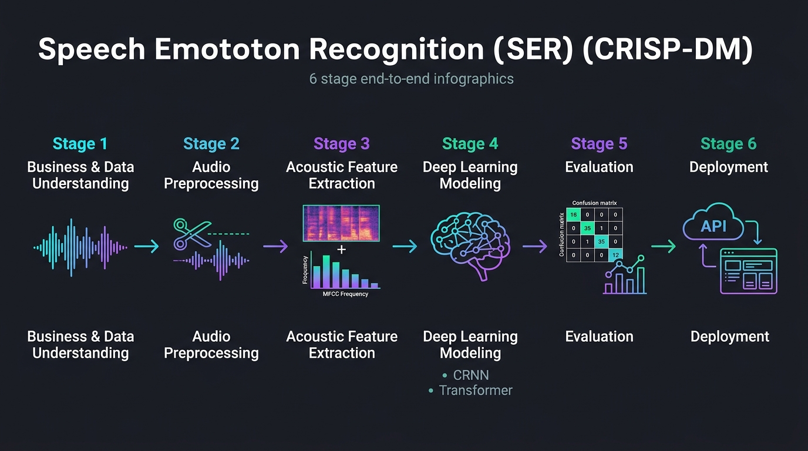
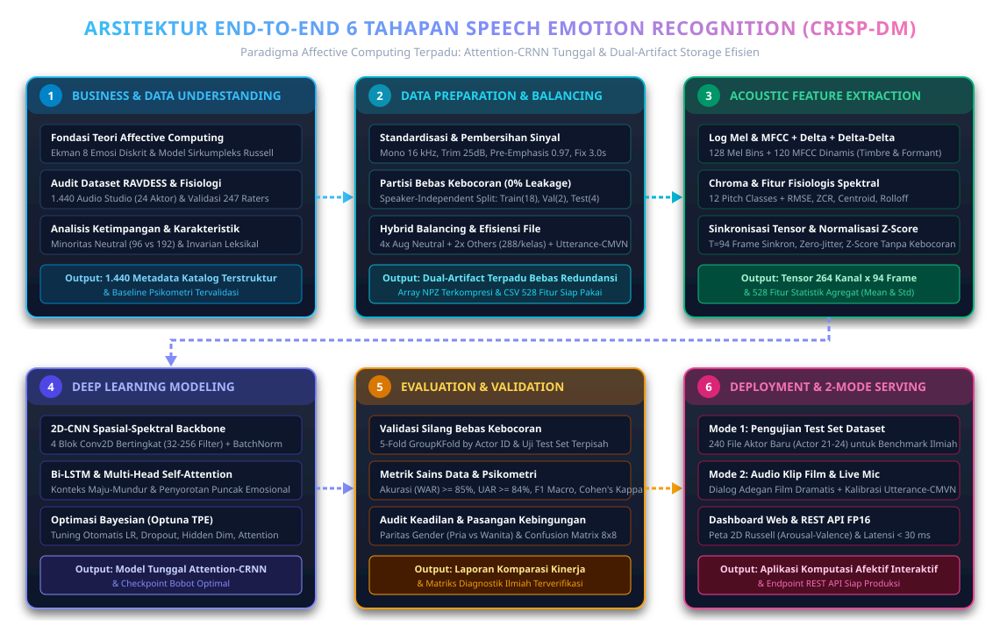

# Business Understanding: Speech Emotion Recognition (SER)

**Sumber Dataset:** [RAVDESS Emotional Speech Audio (Kaggle)](https://www.kaggle.com/datasets/uwrfkaggler/ravdess-emotional-speech-audio)

---

## 1. Latar Belakang & Deskripsi Proyek
Speech Emotion Recognition (SER) merupakan salah satu bidang krusial dalam pemrosesan sinyal audio digital dan kecerdasan buatan (*Artificial Intelligence*). Dalam komunikasi manusia, informasi tidak hanya disampaikan melalui kata-kata verbal (*linguistic content*), melainkan juga melalui karakteristik akustik vokal (*paralinguistic acoustic cues*), seperti intonasi, dinamika nada (*pitch*), tempo, modulasi frekuensi, dan intensitas energi suara.

Pada proyek sains data ini, sistem dibangun untuk mengidentifikasi dan mengklasifikasikan kondisi emosi penutur secara otomatis berdasarkan rekaman suara menggunakan dataset standar internasional **RAVDESS** (*Ryerson Audio-Visual Database of Emotional Speech and Song*). Dataset ini memiliki **1.440 file audio** percakapan dengan **8 kategori emosi** yang diperagakan oleh **24 aktor profesional** (12 pria dan 12 wanita).

---

## 2. Tujuan Bisnis & Sasaran Proyek (Business Objectives)
1. **Otomatisasi Analisis Emosi Vokal:** Mengurangi ketergantungan pada asesmen manual subjektif dalam mengenali suasana emosi seseorang dari rekaman percakapan.
2. **Penerapan Nyata di Industri:**
   - **Customer Support / Call Center:** Analisis sentimen otomatis untuk mendeteksi eskalasi kemarahan (*anger*) atau ketidakpuasan pelanggan secara *real-time*, sehingga dapat segera dialihkan ke supervisor.
   - **Kesehatan Mental & Psikiatri:** Membantu dokter atau psikolog mendeteksi indikasi depresi, kecemasan (*anxiety/fear*), atau kestabilan emosi pasien melalui analisis pola akustik suara.
   - **Human-Computer Interaction (HCI) & Empathic AI:** Memungkinkan asisten suara digital (*voice bot*) merespons pengguna dengan gaya bicara dan empati yang sesuai dengan kondisi emosional pengguna.

---

## 3. Sasaran Teknis Sains Data (Technical & Data Science Objectives)
1. **Pipeline Pemrosesan Sinyal & Penyeimbangan Data:** Membangun alur *Data Preparation* yang mencakup pembersihan sinyal, pemotongan keheningan (*silence trimming*), normalisasi bebas kebocoran data (*leak-free scaling*), serta penanganan ketimpangan kelas (*class balancing*) pada kelas minoritas.
2. **Ekstraksi Fitur Akustik Multi-Domain:** Mengekstraksi representasi waktu-frekuensi komprehensif (*Log Mel-Spectrogram, MFCC beserta $\Delta$ & $\Delta\Delta$, Chroma STFT, RMSE, Zero-Crossing Rate, Spectral Centroid, dan Spectral Rolloff*).
3. **Pemodelan Tunggal & Optimasi Hiperparameter:** Mengimplementasikan arsitektur **Attention-based CRNN (2D-CNN + Bi-LSTM + Multi-Head Self-Attention)** yang dioptimasi menggunakan **Bayesian Optimization (Optuna TPE)**.
4. **Target Performa Evaluasi Ilmiah:** Mencapai **Akurasi (WAR) $\ge 85\%$**, **Macro Precision $\ge 85\%$**, dan **Unweighted Average Recall (UAR) $\ge 84\%$** menggunakan skema validasi bebas kebocoran penutur (*Speaker-Independent GroupKFold*).

---

## 4. Alur Diagram 6 Tahapan CRISP-DM untuk Data Suara

Berikut adalah representasi visual diagram alur 6 tahapan pemrosesan data suara (*Speech Emotion Recognition*):

> *Gambar 4.1: Infografis Alur End-to-End Pemrosesan Sinyal Suara & Speech Emotion Recognition (CRISP-DM).*

Diagram alur teknis beresolusi tinggi (Vektor SVG) untuk rincian sub-komponen tiap tahapan:

> *Gambar 4.2: Diagram Alur Teknis Rinci Sub-Komponen Pipeline (Tahap 1 s.d. Tahap 6).*

---

## 5. Rincian Mendalam 6 Tahapan Proyek

### Tahap 1: Data Understanding & Karakteristik Dataset RAVDESS

Dataset RAVDESS memiliki skema penamaan file terstruktur yang terdiri dari 7 pengenal numerik (`03-01-XX-YY-ZZ-RR-AA.wav`):
1. **Modality (`03`):** Audio-only.
2. **Vocal Channel (`01`):** Speech (percakapan normal, bukan nyanyian).
3. **Emotion (`01`–`08`):**
   - `01` = *Neutral* (Netral) — **96 sampel** (hanya memiliki 1 tingkat intensitas)
   - `02` = *Calm* (Tenang) — **192 sampel**
   - `03` = *Happy* (Bahagia) — **192 sampel**
   - `04` = *Sad* (Sedih) — **192 sampel**
   - `05` = *Angry* (Marah) — **192 sampel**
   - `06` = *Fearful* (Takut) — **192 sampel**
   - `07` = *Disgust* (Jijik) — **192 sampel**
   - `08` = *Surprised* (Terkejut) — **192 sampel**
4. **Emotional Intensity (`01`–`02`):** `01` = Normal, `02` = Strong (Kuat). *(Catatan: Kelas Neutral tidak memiliki intensitas Strong).*
5. **Statement (`01`–`02`):**
   - `01` = *"Kids are talking by the door"*
   - `02` = *"Dogs are sitting by the door"*
6. **Repetition (`01`–`02`):** Pengulangan ke-1 dan ke-2.
7. **Actor ID (`01`–`24`):** Nomor Ganjil = Aktor Pria (12 orang), Nomor Genap = Aktor Wanita (12 orang).

---

### Tahap 2: Data Preparation & Audio Preprocessing Pipeline

Tahap *Data Preparation* dirancang secara sistematis untuk membersihkan sinyal mentah, menyeragamkan dimensi waktu, menangani ketimpangan kelas (*class imbalance*), dan mencegah kebocoran data (*data leakage*):

#### 1. Audit Integritas File & Penyeragaman Format Sinyal
- **Pemeriksaan File Korup (*Sanity Check*):** Memastikan seluruh 1.440 file `.wav` dapat dibaca tanpa *zero-length array* atau nilai `NaN/Inf`.
- **Konversi Kanal Mono:** Mengubah file yang berformat stereo menjadi kanal tunggal (*mono*) dengan merata-ratakan amplitudo kanal kiri dan kanan.
- **Downsampling Frekuensi ($48\text{ kHz} \to 16\text{ kHz}$):** Menurunkan *sampling rate* asli $48.000\text{ Hz}$ ke $16.000\text{ Hz}$ (batas frekuensi Nyquist $8\text{ kHz}$). Rentang ini mencakup seluruh informasi frekuensi vokal dan formant manusia sekaligus memangkas beban komputasi sebesar $3\times$ lipat.

#### 2. Pembersihan Sinyal & Standardisasi Durasi
- **Pre-Emphasis Filtering:** Menerapkan filter orde pertama untuk memperkuat frekuensi tinggi yang secara alami teredam saat produksi suara manusia:
  $$y[n] = x[n] - \alpha \cdot x[n-1], \quad \alpha = 0.97$$
- **Peak Amplitude Normalization:** Menormalisasi amplitudo gelombang suara ke rentang $[-1.0, 1.0]$ agar volume rekaman antar-aktor tidak mendominasi bobot *training*:
  $$x_{\text{norm}}[n] = \frac{x[n]}{\max(|x[n]|) + \epsilon}$$
- **Silence Removal (Trimming):** Memotong bagian hening (*dead air*) di awal dan akhir rekaman menggunakan ambang energi $\text{top\_db} = 25\text{ dB}$.
- **Fixed Duration Standardization ($3.0\text{ Detik} = 48.000\text{ Sampel}$):**
  - Rekaman dengan durasi $< 3.0\text{ detik}$ diberi *symmetric zero-padding* (penambahan nilai nol seimbang di ujung awal dan akhir).
  - Rekaman dengan durasi $> 3.0\text{ detik}$ dipotong tepat di bagian tengah (*center cropping*) agar inti pengucapan kalimat tetap utuh.

#### 3. Pembagian Data Bebas Kebocoran (*Speaker-Independent Splitting*)
- Sebelum dilakukan augmentasi, penyeimbangan data, maupun normalisasi, dataset dibagi terlebih dahulu berdasarkan **Actor ID** (*Leave-Actors-Out*) dengan menjaga keseimbangan gender (**Pria = Ganjil**, **Wanita = Genap**):
  1. **Data Training (`Train Set` — 75% / 18 Aktor: `Actor 01–18`, 9 Pria & 9 Wanita):** **1.080 sampel asli** (sebelum *balancing*).
  2. **Data Validation (`Validation Set` — 8,33% / 2 Aktor: `Actor 19–20`, 1 Pria & 1 Wanita):** **120 sampel asli** murni tanpa augmentasi (untuk *Optuna Hyperparameter Tuning* & *Early Stopping*).
  3. **Data Testing (`Testing Set` — 16,67% / 4 Aktor: `Actor 21–24`, 2 Pria & 2 Wanita):** **240 sampel asli** murni tanpa augmentasi (untuk evaluasi akhir penutur baru).
  4. **Partisi 5-Fold Stratified GroupKFold (`Fold 0–4`):** Menyediakan 5 kelompok aktor terpisah untuk pengujian validasi silang (*5-Fold Cross-Validation*).
- Langkah ini wajib dilakukan **sebelum** augmentasi agar variasi augmentasi dari satu rekaman tidak pernah bocor ke *Validation* maupun *Testing Set*.

| Subset Data | Rentang Aktor | Komposisi Gender | Jumlah Sampel Asli | Jumlah Sesudah *Hybrid Class Balancing* | Peran dalam Pipeline |
| :--- | :--- | :--- | :--- | :--- | :--- |
| **Data Training (`X_train`)** | `Actor 01–18` (18 Aktor) | 9 Pria & 9 Wanita | **1.080 sampel** (`75,00%`) | **2.304 sampel** (`288 sampel/kelas`, 100% seimbang) | Pelatihan model & perhitungan $\mu_{\text{train}}, \sigma_{\text{train}}$ |
| **Data Validation (`X_val`)** | `Actor 19–20` (2 Aktor) | 1 Pria & 1 Wanita | **120 sampel** (`8,33%`) | **120 sampel** (Murni asli tanpa augmentasi) | *Hyperparameter Tuning (Optuna)* & *Early Stopping* |
| **Data Testing (`X_test`)** | `Actor 21–24` (4 Aktor) | 2 Pria & 2 Wanita | **240 sampel** (`16,67%`) | **240 sampel** (Murni asli tanpa augmentasi) | Pengujian akhir model pada penutur baru (Tahap 5) |

#### 4. Penyeimbangan Data (*Class Balancing* — Di Proses Mana Diterapkan?)
- **Analisis Kebutuhan:** **Sangat Dibutuhkan.** Pada RAVDESS, kelas *Neutral* hanya memiliki **96 sampel (6,67%)**, sedangkan ke-7 kelas emosi lainnya masing-masing memiliki **192 sampel (13,33%)** (rasio ketimpangan $1 : 2$). Tanpa penyeimbangan data, model akan cenderung mengabaikan kelas *Neutral* sehingga nilai *Recall* pada kelas *Neutral* turun drastis.
- **Mengapa Tidak Menggunakan SMOTE Biasa?** Metode interpolasi tabular seperti SMOTE tidak digunakan pada sinyal audio/spektrogram 2D karena pencampuran linier antar dua rekaman menghasilkan efek suara bertumpuk (*ghosting/phase cancellation*) yang merusak struktur harmonik dan *formant* vokal.
- **Urutan & Lokasi Penerapan Penyeimbangan Data (*Hybrid Class Balancing* pada 2 Proses):**
  - **Alur Urutan Proses:** `Pembersihan Sinyal` $\to$ `Pembagian Data Train / Validation / Test` $\to$ **`Penyeimbangan Data (Hanya pada Data Training)`** $\to$ `Ekstraksi Fitur & Normalisasi Z-Score`.
  1. **Proses 1 — Pada Tahap *Data Preparation* (Targeted Audio Augmentation Oversampling pada *Data Training*):**
     - Diterapkan **hanya pada subset Data Training (`Actor 01–18`)** setelah pembagian data. **Data Validation (`120 sampel`) dan Data Testing (`240 sampel`) tidak diseimbangkan/tidak diaugmentasi** agar evaluasi menguji kondisi distribusi nyata tanpa *data leakage*.
     - Untuk **7 kelas mayoritas** (`144 sampel latih asli/kelas`), setiap file digandakan $2\times$ ($1\text{ Asli} + 1\text{ Augmentasi}$) menghasilkan **288 sampel/kelas**.
     - Khusus untuk **kelas minoritas (*Neutral*, `72 sampel latih asli`)**, setiap file digandakan $4\times$ ($1\text{ Asli} + 3\text{ Augmentasi berbeda}$: *White Noise, Pitch Shift, dan Time Stretch*) menghasilkan **288 sampel**.
     - Hasil akhirnya, seluruh **8 kelas emosi pada Data Training menjadi 100% seimbang (`288 sampel/kelas`, total `2.304 sampel latih`)**.
  2. **Proses 2 — Pada Tahap *Modeling* (Inverse Class-Frequency Loss Weighting saat *Training*):**
     - Diterapkan di dalam fungsi objektif *Weighted Categorical Cross-Entropy Loss* menggunakan bobot proporsional:
       $$w_k = \frac{N_{\text{train}}}{K \cdot N_{k,\text{train}}}$$
     - Berfungsi sebagai pengaman tingkat algoritma saat pembaruan gradien *backpropagation* (terutama saat menjalankan *5-Fold Cross-Validation*).

#### 5. Augmentasi Data Audio & Spektrogram (Khusus Subset *Training*)
Untuk mencegah *overfitting* pada ukuran data 1.440 sampel, diterapkan 4 teknik augmentasi:
- **Additive White Gaussian Noise (AWGN):** Menambahkan derau latar dengan rasio sinyal-ke-derau $\text{SNR} \in [15, 25]\text{ dB}$:
  $$x_{\text{aug}}[n] = x[n] + \gamma \cdot \mathcal{N}(0, 1)$$
- **Pitch Shifting:** Menggeser tinggi nada secara acak sebesar $\pm 1.5\text{ semitone}$ tanpa mengubah durasi kalimat.
- **Time Stretching:** Mengubah kecepatan bicara dengan faktor laju $r \in [0.9, 1.1]$ diikuti penyesuaian ulang ke panjang $3.0\text{ detik}$.
- **SpecAugment (Frequency & Time Masking):** Menutup pita frekuensi dan bingkai waktu secara acak langsung pada matriks spektrogram saat pelatihan agar model tidak menghafal pola lokal sempit.

#### 6. Normalisasi Fitur Bebas Kebocoran (*Leak-Free Z-Score Scaling*)
- Rata-rata ($\mu_{\text{train}}$) dan simpangan baku ($\sigma_{\text{train}}$) per kanal fitur dihitung **hanya dari subset Training**, kemudian diterapkan untuk menstandarisasi subset *Training*, *Validation*, dan *Testing*:
  $$z = \frac{X - \mu_{\text{train}}}{\sigma_{\text{train}} + \epsilon}$$

---

### Tahap 3: Ekstraksi Fitur Akustik (Matematis & Makna Fisik Emosi)

Seluruh sinyal bersih berdurasi $3.0\text{ detik}$ ($48.000\text{ sampel}$) diekstraksi menggunakan ukuran jendela FFT $N_{\text{FFT}} = 1024$ ($64\text{ ms}$) dan pergeseran bingkai *hop length* $H = 512$ ($32\text{ ms}$), menghasilkan **$T = 94\text{ time frames}$** per rekaman:

#### 1. Short-Time Fourier Transform (STFT) & Spektrogram
Mengubah sinyal waktu non-stasioner menjadi representasi waktu-frekuensi menggunakan jendela Hann $w[n]$:
$$X(m, k) = \sum_{n=0}^{N-1} x[n + mH] \cdot w[n] \cdot e^{-j \frac{2\pi k n}{N}}$$

#### 2. Skala Mel & Log Mel-Spectrogram (128 Mel Bins)
Memetakan frekuensi linier Hertz ($f$) ke skala persepsi pendengaran manusia (Mel):
$$M(f) = 2595 \cdot \log_{10} \left(1 + \frac{f}{700}\right)$$
Energi spektrum diproyeksikan ke $M = 128$ filterbank segitiga Mel $H_m[k]$ dan dikonversi ke skala desibel ($\text{dB}$):
$$S_{\text{dB}}(m, t) = 10 \cdot \log_{10}\left( \sum_{k=0}^{K-1} |X(t, k)|^2 \cdot H_m[k] + \epsilon \right)$$

#### 3. Mel-Frequency Cepstral Coefficients (MFCC + $\Delta$ + $\Delta\Delta$)
Mengekstrak amplop spektral saluran vokal (*vocal tract timbre*) melalui *Discrete Cosine Transform* (DCT) terhadap Log Mel-Spectrogram untuk menghasilkan $40$ koefisien statis, dilengkapi turunan pertama ($\Delta$, kecepatan perubahan intonasi) dan turunan kedua ($\Delta\Delta$, percepatan perubahan intonasi):
$$c_n = \sum_{m=1}^{M} S_{\text{dB}}[m] \cdot \cos\left( \frac{\pi n (m - 0.5)}{M} \right), \quad \Delta c_n(t) = \frac{\sum_{\tau=-D}^{D} \tau \cdot c_n(t+\tau)}{\sum_{\tau=-D}^{D} \tau^2}$$

#### 4. Root Mean Square Energy (RMSE)
Mengukur intensitas atau kenyaringan energi suara pada tiap bingkai waktu:
$$\text{RMSE}_t = \sqrt{\frac{1}{N} \sum_{n=0}^{N-1} x_t[n]^2}$$

#### 5. Zero-Crossing Rate (ZCR)
Mengukur frekuensi perubahan tanda gelombang melewati titik nol, yang mencerminkan tingkat desis atau kepadatan frekuensi tinggi:
$$\text{ZCR}_t = \frac{1}{2N} \sum_{n=1}^{N-1} |\operatorname{sgn}(x_t[n]) - \operatorname{sgn}(x_t[n-1])|$$

#### 6. Spectral Centroid & Spectral Rolloff
- **Spectral Centroid:** Titik pusat massa frekuensi yang mengindikasikan "kecerahan" (*brightness*) suara:
  $$\text{Centroid}_t = \frac{\sum_{k=0}^{K-1} f_k \cdot |X_t(k)|}{\sum_{k=0}^{K-1} |X_t(k)|}$$
- **Spectral Rolloff:** Batas frekuensi di mana $85\%$ energi spektral terkonsentrasi di bawahnya:
  $$\sum_{k=0}^{R_t} |X_t(k)| = 0.85 \sum_{k=0}^{K-1} |X_t(k)|$$

#### 7. Chroma STFT (12 Pitch Classes)
Memproyeksikan energi spektrum ke dalam 12 kelas tinggi nada kromatik ($C, C\sharp, D, \dots, B$) untuk menangkap modulasi nada bicara dan struktur harmonik vokal.

#### Tabel Pemetaan Karakteristik Fitur Akustik terhadap 8 Kelas Emosi:

| Kategori Emosi | RMSE (Energi) | ZCR (Desis/Frekuensi Tinggi) | Pitch ($F_0$) & Centroid | Karakteristik Spektrogram & MFCC |
| :--- | :--- | :--- | :--- | :--- |
| **Marah (Angry)** | Sangat Tinggi | Sangat Tinggi | Sangat Tinggi & Fluktuatif | Energi frekuensi atas sangat padat dan tajam |
| **Bahagia (Happy)** | Tinggi | Sedang – Tinggi | Tinggi, Variasi Nada Luas | Kontur harmonik cerah, *pitch* naik di akhir |
| **Sedih (Sad)** | Rendah | Sangat Rendah | Rendah, Nada Datar/Monoton | Energi terkonsentrasi di pita frekuensi bawah |
| **Takut (Fearful)** | Sedang – Tinggi | Tinggi | Tinggi, Getaran Cepat | Spektrum tidak stabil, *jitter/shimmer* tinggi |
| **Tenang (Calm)** | Rendah – Sedang | Rendah | Rendah & Terkontrol | Transisi antar-frame sangat halus dan stabil |
| **Netral (Neutral)** | Sedang | Sedang | Sedang & Datar | Tidak ada lonjakan energi atau deviasi frekuensi |
| **Jijik (Disgust)** | Rendah – Sedang | Sedang | Rendah, Menurun di Akhir | Artikulasi melambat dengan penekanan frekuensi rendah |
| **Terkejut (Surprised)**| Tinggi | Tinggi | Lonjakan Nada Tiba-tiba | *Onset* serangan energi sangat curam dan cepat |

---

### Tahap 4: Pemodelan Deep Learning & Optimasi Hiperparameter

Proyek ini berfokus pada satu arsitektur *Deep Learning* hibrida yang paling sesuai dengan karakteristik dataset RAVDESS, yaitu **Attention-based CRNN (2D-CNN + Bi-LSTM + Multi-Head Self-Attention)**.

#### 1. Alasan Pemilihan Model Tunggal untuk Dataset RAVDESS
- **Peka terhadap Perbedaan Prosodi pada Kalimat Identik:** Karena seluruh rekaman RAVDESS menggunakan dua kalimat yang sama, pembeda emosi 100% terletak pada pola spektral-waktu. Kombinasi **2D-CNN** (spasial-frekuensi) dan **Bi-LSTM** (urutan waktu) langsung mengekstrak pola intonasi tersebut tanpa terganggu kesamaan kata.
- **Tahan *Overfitting* pada Ukuran Data 1.440 Sampel:** Memiliki *inductive bias* spasial dan sekuensial yang jauh lebih efisien parameter dibandingkan model berbasis Transformer murni (seperti Conformer/Wav2Vec) yang membutuhkan puluhan ribu sampel.

#### 2. Arsitektur Detail: Attention-based CRNN
1. **2D-CNN Backbone (4 Convolutional Blocks) — Peningkat Presisi Spasial-Spektral:**
   - Menerima tensor fitur akustik terintegrasi sepanjang $94\text{ time frames}$.
   - Setiap blok terdiri dari `Conv2D (Kernel 3×3, Padding=1)` $\to$ `BatchNorm2D` $\to$ `ELU Activation` $\to$ `MaxPool2D` $\to$ `SpatialDropout2D`, dengan jumlah filter bertingkat ($32 \to 64 \to 128 \to 256$).
   - Memisahkan tekstur frekuensi antar-emosi secara tajam untuk meminimalkan *False Positive*.
2. **Bidirectional LSTM (2-Layer Bi-LSTM) — Penangkap Konteks Temporal:**
   - Peta fitur dari CNN diratakan pada dimensi frekuensi dan dimasukkan ke dalam `Bi-LSTM` untuk mempelajari dinamika perubahan emosi dari awal kalimat ke akhir (*forward*) dan sebaliknya (*backward*).
3. **Multi-Head Self-Attention Layer — Penguat Recall (Sensitivitas Puncak Emosi):**
   - Menghitung matriks perhatian (*Scaled Dot-Product Attention*) di seluruh bingkai waktu:
     $$\text{Attention}(Q, K, V) = \operatorname{softmax}\left(\frac{QK^T}{\sqrt{d_k}}\right)V$$
   - Memberikan bobot tertinggi pada suku kata atau detik rekaman tempat puncak emosi terjadi dan menekan bagian jeda.
4. **Classification Head:**
   - `Global Attention Pooling` $\to$ `Dense Layer (128 units, ELU)` $\to$ `BatchNorm1D & Dropout` $\to$ `Softmax Layer (8 kelas emosi)`.

#### 3. Optimasi Hiperparameter (*Hyperparameter Optimization / Tuning*)
Untuk mendapatkan konfigurasi model dengan performa tertinggi dan mencegah pemilihan parameter secara tebak-tebakan (*trial-and-error* manual), dilakukan optimasi hiperparameter otomatis:
- **Algoritma Optimasi:** **Bayesian Optimization menggunakan Optuna — Tree-structured Parzen Estimator (TPE)** sebanyak $30\text{–}50\text{ trials}$, dilengkapi **MedianPruner** untuk menghentikan *trial* yang memiliki kurva validasi buruk sejak *epoch* awal.
- **Fungsi Objektif Optimasi:** Memaksimalkan skor **Validation UAR (*Unweighted Average Recall*)**.
- **Ruang Pencarian Hiperparameter (*Search Space*):**

| Kategori Parameter | Nama Hiperparameter | Rentang / Pilihan Pencarian (*Search Space*) | Nilai Default / Kandidat Optimal |
| :--- | :--- | :--- | :--- |
| **Optimizer & LR** | `optimizer_name` | `["AdamW", "RAdam"]` | `AdamW` |
| | `learning_rate` | $[1 \times 10^{-4}, 5 \times 10^{-3}]$ (*Log-uniform*) | $1 \times 10^{-3}$ |
| | `weight_decay` (L2 Reg) | $[1 \times 10^{-5}, 1 \times 10^{-2}]$ (*Log-uniform*) | $1 \times 10^{-4}$ |
| **Arsitektur** | `cnn_base_filters` | `[32, 64]` (Bertingkat $\times 2$ tiap blok) | `32` ($32 \to 64 \to 128 \to 256$) |
| | `bilstm_hidden_size` | `[64, 128, 256]` per arah | `128` (Total `256` dua arah) |
| | `num_attention_heads` | `[2, 4, 8]` | `4` Heads |
| **Regularisasi** | `dropout_rate` | $[0.20, 0.50]$ (*Step* $0.05$) | $0.35\text{ – }0.40$ |
| | `label_smoothing` | $[0.0, 0.15]$ | $0.05$ |
| **Pelatihan** | `batch_size` | `[16, 32, 64]` | `32` |

- **Strategi Penjadwalan & Stabilitas Latih (*Training Callbacks*):**
  1. **Learning Rate Scheduler:** `CosineAnnealingWarmRestarts` atau `ReduceLROnPlateau` (menurunkan LR sebesar faktor $0.5$ jika *Validation Loss* stagnan selama $5\text{ epoch}$).
  2. **Early Stopping:** Menghentikan pelatihan otomatis jika *Validation UAR* tidak meningkat selama $15\text{ epoch}$ berturut-turut dan mengembalikan bobot terbaik (*best checkpoint*).
  3. **Gradient Clipping:** Membatasi norma gradien pada $\|\mathbf{g}\|_2 \le 1.0$ untuk menjaga stabilitas pelatihan lapisan Bi-LSTM.

---

### Tahap 5: Strategi Evaluasi & Validasi Ilmiah

Evaluasi dilakukan secara ketat pada hasil **Speaker-Independent 5-Fold GroupKFold** untuk mengukur kemampuan generalisasi model terhadap penutur baru:

#### 1. Perhitungan Matematis Metrik Evaluasi
Untuk klasifikasi multi-kelas ($K = 8$ kelas emosi) dan total sampel uji $N$, setiap kelas ke-$k$ memiliki komponen: *True Positive* ($TP_k$), *False Positive* ($FP_k$), *False Negative* ($FN_k$), dan *True Negative* ($TN_k$).

##### A. Metrik Per-Kelas Emosi ($k \in \{1, \dots, 8\}$)
1. **Precision Kelas ke-$k$ ($P_k$):** Ketepatan prediksi model pada emosi $k$:
   $$P_k = \frac{TP_k}{TP_k + FP_k}$$
2. **Recall / Sensitivity Kelas ke-$k$ ($R_k$):** Kepekaan model mengenali seluruh sampel emosi $k$:
   $$R_k = \frac{TP_k}{TP_k + FN_k}$$
3. **F1-Score Kelas ke-$k$ ($F1_k$):** Rata-rata harmonik antara Presisi dan Recall pada kelas $k$:
   $$F1_k = \frac{2 \cdot P_k \cdot R_k}{P_k + R_k}$$

##### B. Metrik Agregat Global (Standar Ilmiah SER / INTERSPEECH)
1. **WAR (*Weighted Average Recall*) / Overall Accuracy:**
   Persentase total prediksi emosi yang benar dari seluruh sampel uji ($N$):
   $$\text{Accuracy (WAR)} = \frac{\sum_{k=1}^{K} TP_k}{N} \times 100\%$$
2. **UAR (*Unweighted Average Recall*) / Macro Recall / Balanced Accuracy:**
   Metrik standar wajib kompetisi INTERSPEECH ComParE yang menghitung rata-rata *Recall* ke-8 kelas secara setara:
   $$\text{UAR (Macro Recall)} = \frac{1}{K} \sum_{k=1}^{K} \left( \frac{TP_k}{TP_k + FN_k} \right) \times 100\%$$
3. **Macro-Averaged Precision:**
   Rata-rata presisi di seluruh 8 kelas emosi untuk memastikan rendahnya *False Positive*:
   $$\text{Macro Precision} = \frac{1}{K} \sum_{k=1}^{K} \left( \frac{TP_k}{TP_k + FP_k} \right) \times 100\%$$
4. **Macro F1-Score & Weighted F1-Score:**
   $$\text{Macro } F1 = \frac{1}{K} \sum_{k=1}^{K} F1_k, \quad \text{Weighted } F1 = \sum_{k=1}^{K} \left( \frac{N_k}{N} \cdot F1_k \right)$$
5. **Cohen’s Kappa ($\kappa$) & Multi-Class ROC-AUC (One-vs-Rest / OvR):**
   - **Cohen’s Kappa ($\kappa$):** Mengukur kesepakatan prediksi di atas kebetulan acak ($p_o$ = akurasi observasi, $p_e$ = peluang kesepakatan acak; target $\kappa > 0.80$):
     $$\kappa = \frac{p_o - p_e}{1 - p_e}$$
   - **Multi-Class ROC-AUC (OvR):** Mengevaluasi ketajaman kalibrasi probabilitas *Softmax* antar-kelas.

#### 2. Analisis Diagnostik & Evaluasi Mendalam
1. **Normalized & Absolute Confusion Matrix ($8 \times 8$):** Memetakan pasangan emosi yang rawan tertukar karena kemiripan karakteristik akustik (*Angry* vs *Happy/Surprised* pada *High-Arousal*, serta *Sad* vs *Calm/Neutral* pada *Low-Arousal*).
2. **Evaluasi Berdasarkan Intensitas Emosi (*Normal vs Strong Intensity*):** Membandingkan akurasi model pada emosi berintensitas **Normal (`01`)** vs **Strong (`02`)**.
3. **Evaluasi Keadilan Gender (*Male vs Female Actors*):** Membandingkan metrik WAR dan UAR antara aktor **Pria (ID Ganjil)** dan **Wanita (ID Genap)** untuk memastikan model bebas dari bias gender.
4. **Kurva Konvergensi Pelatihan (*Learning Curves*):** Visualisasi grafik *Training vs Validation Loss, Accuracy, dan UAR* per *epoch*.

---

### Tahap 6: Rencana Arsitektur Deployment & Serving

Sistem diimplementasikan ke dalam arsitektur siap pakai (*production-ready*):
1. **Model Export & Optimization:**
   - Konversi bobot terbaik (*best checkpoint*) ke format **ONNX Runtime** atau **TorchScript FP16** dengan waktu inferensi $< 40\text{ ms}$ per rekaman $3\text{ detik}$.
2. **Backend Inference Service (FastAPI):**
   - Endpoint REST `POST /api/v1/predict-emotion` yang menerima unggahan file `.wav` atau aliran audio, menjalankan pipeline *preprocessing* dan ekstraksi fitur identik dengan tahap pelatihan, lalu mengembalikan JSON berisi label emosi beserta probabilitas ke-8 kelas.
3. **Frontend Dashboard Interaktif (Streamlit):**
   - **Live Audio Recorder & File Uploader:** Fitur rekam suara langsung dari mikrofon pengguna atau unggah file `.wav`.
   - **Acoustic Visualizer:** Menampilkan *waveform* setelah *silence trimming* dan visualisasi *Log Mel-Spectrogram* / *Attention Weights* (bagian detik suara mana yang memicu prediksi emosi).
   - **Emotion Probability & Affective Mapping:** Grafik probabilitas ke-8 kelas emosi disertai pemetaan dimensi afektif (*Arousal*: Energi Tinggi/Rendah, dan *Valence*: Positif/Negatif).
