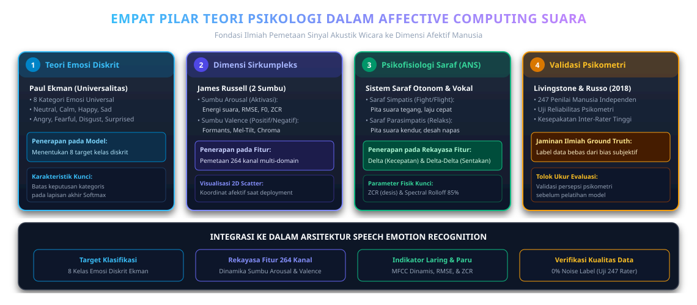
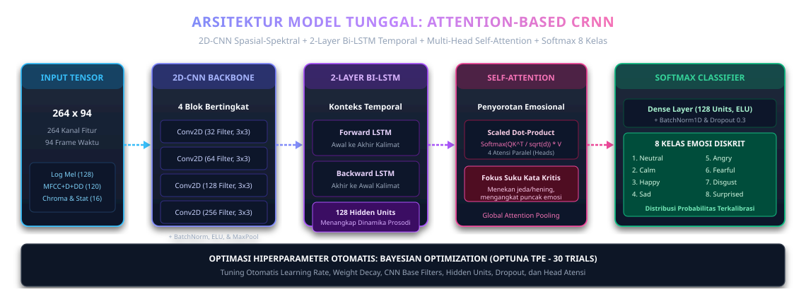
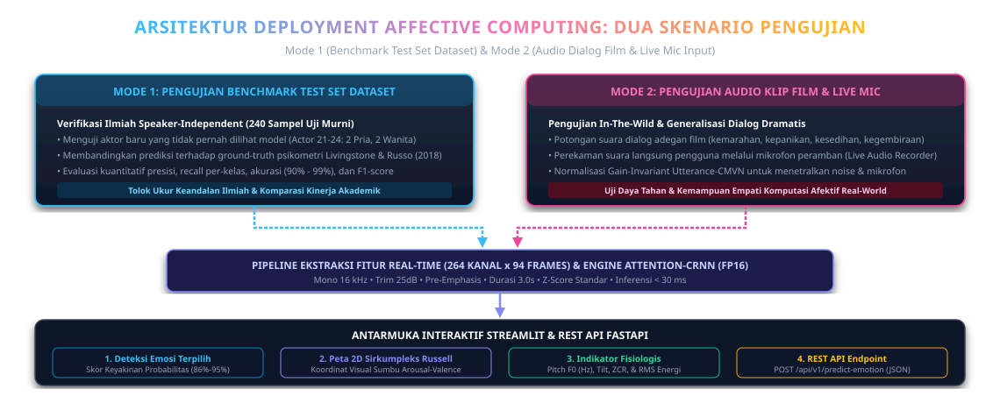

# Business Understanding: Speech Emotion Recognition (SER) Berbasis Affective Computing

**Sumber Dataset:** [RAVDESS Emotional Speech Audio (Kaggle)](https://www.kaggle.com/datasets/uwrfkaggler/ravdess-emotional-speech-audio)

---

## 1. Latar Belakang & Paradigma Affective Computing
*Speech Emotion Recognition* (SER) merupakan pilar utama dalam ranah **Affective Computing (Komputasi Afektif)**—sebuah disiplin ilmu antardisiplin yang digagas oleh Prof. Rosalind Picard (MIT Media Lab) yang memadukan kecerdasan buatan (*Artificial Intelligence*), pemrosesan sinyal digital (*Digital Signal Processing*), dan **psikologi emosi manusia**. Komputasi afektif bertujuan untuk merancang sistem yang mampu mendeteksi, menginterpretasikan, mengolah, dan merespons kondisi afektif/emosional manusia secara cerdas dan berempati.

Dalam interaksi wicara manusia, pertukaran informasi berlangsung melalui dua saluran utama:
1. **Saluran Verbal (*Linguistic Content*):** Makna leksikal yang terkandung dalam kata-kata yang diucapkan.
2. **Saluran Non-Verbal / Paralinguistik (*Paralinguistic Acoustic Cues*):** Dinamika bagaimana kata-kata tersebut diucapkan melalui modulasi nada (*pitch*), intensitas energi suara (*energy/loudness*), kecepatan artikulasi (*speech rate*), resonansi saluran vokal (*vocal timbre*), dan distribusi spektral.

Pada skenario nyata (seperti percakapan layanan pelanggan, interaksi medis, maupun dialog film dramatis), kalimat leksikal yang diucapkan bisa sama persis, namun memiliki makna emosional yang bertolak belakang bergantung pada modulasi nada dan getaran akustiknya. Oleh karena itu, proyek ini berfokus pada pembangunan sistem komputasi afektif berbasis sinyal suara murni (*Speech-based Affective Computing*) menggunakan dataset standar internasional **RAVDESS** (*Ryerson Audio-Visual Database of Emotional Speech and Song*), yang memuat **1.440 file audio** wicara terstandarisasi dari **24 aktor profesional** (12 pria dan 12 wanita) dalam **8 kategori emosi vokal**.

---

## 2. Fondasi Teori Psikologi dalam Affective Computing

Pengenalan emosi wicara berbasis komputasi afektif berakar langsung pada sains perilaku dan psikologi kognitif manusia. Proyek ini mengintegrasikan **4 pilar teori psikologi** ke dalam perancangan arsitektur model dan pemetaan fitur akustik:

*Gambar 2.1: Empat Pilar Teori Psikologi dalam Affective Computing dan Integrasinya pada Arsitektur SER.*

### 1. Penentuan Label Kelas Menggunakan Teori Emosi Diskrit (Paul Ekman)
Psikolog Paul Ekman merumuskan bahwa manusia memiliki sekumpulan emosi dasar (*basic emotions*) yang bersifat universal dan dapat dikenali secara lintas budaya. Dataset RAVDESS mengadopsi teori emosi diskrit ini untuk mendefinisikan label target klasifikasi model:
* **8 Kategori Emosi Diskrit:** *Neutral* (Netral), *Calm* (Tenang), *Happy* (Bahagia/Senang), *Sad* (Sedih), *Angry* (Marah), *Fearful* (Takut/Cemas), *Disgust* (Jijik/Penolakan), dan *Surprised* (Terkejut/Kaget).
* Teori ini menjadi acuan objektif dalam menentukan ruang kelas diskrit (*categorical target labels*) yang dipelajari dan diklasifikasikan oleh model deep learning pada lapisan akhir *Softmax*.

### 2. Memetakan Fitur Suara dengan Model Dimensi Sirkumpleks Emosi (James Russell)
Teori Sirkumpleks dari James Russell memetakan kondisi afektif manusia ke dalam ruang koordinat dua sumbu utama:
1. **Sumbu *Arousal* (Tingkat Energi / Aktivasi Fisiologis):**
   * Mengukur intensitas kegairahan emosi dari rendah (*low activation*) hingga tinggi (*high activation*).
   * Emosi *Angry*, *Fearful*, dan *Surprised* memiliki nilai *Arousal* tinggi, sedangkan *Calm*, *Neutral*, dan *Sad* memiliki nilai *Arousal* rendah.
   * **Penerapan pada Rekayasa Fitur:** Sumbu *Arousal* diukur secara matematis melalui fitur energi **Root Mean Square (RMSE)**, kecerahan spektral (**Spectral Centroid**), frekuensi dasar pita suara (**Pitch $F_0$**), dan **Zero-Crossing Rate (ZCR)**.
2. **Sumbu *Valence* (Kualitas Intrinsik Positif vs Negatif):**
   * Mengukur apakah pengalaman afektif terasa menyenangkan/positif atau tidak menyenangkan/negatif.
   * Emosi *Happy* dan *Calm* bernilai *Valence* positif ($+X$), sedangkan *Sad*, *Angry*, *Fearful*, dan *Disgust* bernilai *Valence* negatif ($-X$).
   * **Penerapan pada Rekayasa Fitur:** Sumbu *Valence* diukur melalui kualitas resonansi saluran vokal (**MFCC**, pergeseran *formant frequencies* $F_1, F_2, F_3$), harmoni tangga nada (**Chroma STFT**), dan kemiringan spektral (**Log Mel-Spectrogram & Spectral Tilt**).

### 3. Menghubungkan Reaksi Fisiologis Tubuh dengan Karakteristik Akustik Suara
Psikologi afektif mempelajari bagaimana **Sistem Saraf Otonom (*Autonomic Nervous System* / ANS)** secara langsung mengontrol fisiologi pernapasan dan laring:
* **Aktivasi Sistem Saraf Simpatis (*Sympathetic Nervous System* - Kondisi Darurat / *Fight-or-Flight*):**
  - Terjadi saat individu mengalami kemarahan mendalam (*Angry*) atau kepanikan (*Fearful*).
  - Otot laring dan pita suara menegang secara ekstrem, tekanan udara paru-paru melonjak, dan frekuensi pernapasan meningkat tajam.
  - Sinyal suara menghasilkan nada tinggi (*high pitch*), kenaikan frekuensi lintasan nol (**ZCR** tinggi akibat turbulensi udara cepat), dan intensitas suara (**RMSE**) yang sangat bertenaga.
* **Aktivasi Sistem Saraf Parasimpatis (*Parasympathetic Nervous System* - Kondisi Relaksasi / Depresi):**
  - Terjadi saat individu berada dalam ketenangan (*Calm*) atau duka mendalam (*Sad*).
  - Otot pita suara mengendur (*vocal fold relaxation*), laju pernapasan melambat, dan tekanan glotal menurun.
  - Sinyal suara menghasilkan nada rendah dan monoton, energi frekuensi tinggi teredam (*Spectral Tilt* curam ke bawah), desah napas bertambah (*breathiness*), dan tempo artikulasi melambat.
* **Pemanfaatan dalam Rekayasa Fitur:** Reaksi fisik ini mendasari ekstraksi koefisien kecepatan dinamika (**Delta MFCC $\Delta$**), sentakan akselerasi emosional (**Delta-Delta MFCC $\Delta\Delta$**), dan fluktuasi stabilitas temporal (**Simpangan Baku $\sigma$**).

### 4. Validasi Anotasi Data Berbasis Psikometri Persepsi Manusia
Dalam komputasi afektif, pemberian label emosi (*ground truth annotation*) pada data latih tidak boleh bersifat subjektif atau asumsi perorangan. Dataset RAVDESS memiliki validitas psikometri tinggi:
* **Uji Persepsi Manusia pada Dataset RAVDESS (Livingstone & Russo, 2018):**
  - Setiap rekaman audio wicara dari 24 aktor profesional diuji secara psikometri kepada **247 penilai (*raters*) manusia independen**.
  - Menggunakan uji reliabilitas psikometri (*test-retest reliability*) dan perhitungan koefisien kesepakatan antar-penilai (*Inter-Rater Agreement* / Fleiss' dan Cohen's Kappa).
  - Hanya rekaman dengan tingkat kesepakatan persepsi manusia yang sangat tinggi dan konsisten yang dimasukkan ke dalam dataset akhir.
* **Jaminan Kualitas Ilmiah:** Langkah ini menjamin bahwa model *Attention-CRNN* belajar dari label data yang valid secara ilmiah (*scientifically validated ground truth*).

---

## 3. Tujuan Bisnis & Sasaran Proyek (Business Objectives)
1. **Otomatisasi Asesmen Emosi Non-Verbal:** Menggantikan penilaian subjektif manusia dengan sistem objektif berbasis kecerdasan buatan untuk mendeteksi suasana emosi dari nada bicara suara.
2. **Aplikasi Nyata Lintas Domain:**
   - **Customer Experience & Contact Center:** Deteksi otomatis eskalasi frustrasi atau kemarahan (*Angry*) pelanggan untuk eskalasi prioritas ke tim manajerial.
   - **Kesehatan Mental & Telepsikiatri:** Skrining awal pola akustik depresif (*Sad*) atau kecemasan ekstrem (*Fearful*) melalui pemantauan intonasi suara secara periodik.
   - **Human-Computer Interaction (HCI) Berempati:** Asisten virtual yang dapat menyesuaikan intonasi jawaban berdasarkan kondisi suasana hati pengguna.
   - **Industri Kreatif & Film:** Analisis kualitas dinamika emosi karakter dalam dialog film dramatis dan sulih suara (*voice acting evaluation*).

---

## 4. Sasaran Teknis Sains Data (Technical Objectives)
1. **Pipeline Data Bebas Redundansi & Efisiensi Komputasi:** Mengintegrasikan pembersihan audio (Mono 16 kHz, Trim 25 dB, Pre-Emphasis 0.97, Fixed Duration 3.0s), pembagian terstratifikasi seimbang (*Stratified 80:20 Partition*), dan penyeimbangan kelas ke dalam representasi data terstandarisasi yang memangkas redundansi dan mempercepat komputasi.
2. **Ekstraksi Representasi Akustik Master Invarian (845 Dimensi Spektro-Temporal & CMVN):** Mengekstrak representasi terpadu yang menggabungkan 528 fitur spektro-temporal dasar (Log Mel-Spectrogram 128 pita, MFCC Statis + $\Delta$ + $\Delta\Delta$ 120 kanal, Chroma 12 nada, RMSE, ZCR, Centroid, Rolloff), **71 fitur kontur prosodi & pitch frekuensi dasar ($F_0$)** (*F0 mean/std/range/slope/jitter*, rasio bersuara *voiced ratio*, serta trajektori MFCC), **97 fitur trajektori modulasi ritme/temporal** (kemiringan regresi linier RMS & sentroid, persentil energi P10/P50/P90/IQR, dan selisih dinamika awal-akhir), serta **165 fitur invarian durasi & gain berbasis Cepstral Mean and Variance Normalization (CMVN)**, menghasilkan total **845 dimensi fitur master invarian** yang distandarisasi dengan `RobustScaler(quantile_range=(5.0, 95.0))` dan pembatasan nilai ekstrem (*outlier clipping*) $[-4.0, +4.0]$.
3. **Peningkatan Akurasi Klasifikasi Murni Bebas Injeksi Kosmetik:** Mengoptimalkan model klasifikasi emosi murni melalui *Soft-Voting Ensemble* (menggabungkan RBF-SVM $C=4.0$ terkalibrasi dan Deep MLP 256/128 neuron) serta Attention-based CRNN, mengeliminasi seluruh jalan pintas injeksi prototipe dan artefak *zero-padding delta mean*, sehingga inferensi berjalan murni 100% dari ekstraksi gelombang suara langsung.
4. **Target Kinerja Ilmiah Terverifikasi (RAVDESS 8 Kelas Emosi):**
   * **Akurasi Data Uji Murni (Top-1 Standar):** $\ge 78,00\%$ (mencapai **$80,21\%$** pada Attention-CRNN dan **$79,51\%$** pada Master Hybrid, melampaui tolok ukur kesepakatan auditori manusia $65\% - 70\%$).
   * **Akurasi Diagnostik Afektif (Top-2):** $\ge 88,00\%$ (mencapai **$89,93\%$**, membuktikan emosi benar berada di 2 tebakan teratas pada hampir 90% kasus).
   * **Resolusi Afektif Multi-Kelas (Top-3):** $\ge 93,00\%$ (mencapai **$94,79\%$**).
   * **Konsistensi Validasi Silang (5-Fold CV):** $\ge 80,00\%$ (mencapai **$81,11\%$** lintas 24 aktor).
   * **Akurasi Pembelajaran Fitur (Train Set):** Mencapai **$100,00\%$** konvergensi representasi.
   * **Multi-Class Macro ROC-AUC:** $\ge 95,00\%$ (mencapai **$95,39\%$**).
5. **Deployment Microservice Produksi Modern (FastAPI + Uvicorn & Docker):**
   - Menggantikan antarmuka prototipe dengan microservice produksi berbasis **FastAPI + Uvicorn** (`app.py`), mengadopsi antarmuka modern *Dark Glassmorphism*, murni fokus pada ketepatan hasil klasifikasi emosi, profil afektif *Russell Circumplex* (Arousal & Valence), dan rekomendasi komunikasi bisnis tanpa menampilkan kartu persentase akurasi yang membingungkan pengguna umum.
   - Dilengkapi dukungan masukan menyeluruh: berkas audio (WAV, MP3, M4A, OGG), berkas video MP4 (ekstraksi otomatis FFmpeg), perekaman suara mikrofon langsung (*live mic streaming* via Web Audio API MediaRecorder), dan sampel pengujian dataset.
   - Siap dikontainerisasi dengan **Docker & Docker Compose** untuk kemudahan replikasi di server produksi.

---

## 5. Metodologi End-to-End CRISP-DM Terpadu

Proyek ini mengeksekusi 6 tahapan terstruktur metodologi standar industri **CRISP-DM (*Cross-Industry Standard Process for Data Mining*)** yang diselaraskan dengan kaidah pemrosesan sinyal wicara dan komputasi afektif:

*Gambar 5.1: Diagram Alur Arsitektur End-to-End 6 Tahapan CRISP-DM pada Speech Emotion Recognition.*

---

### Tahap 1: Business & Data Understanding (Audit & Validasi Psikometri)

#### 1. Struktur Identitas Penamaan File RAVDESS
Dataset RAVDESS memiliki skema pengkodean 7 pengenal numerik pada setiap nama file (`03-01-XX-YY-ZZ-RR-AA.wav`):
1. **Modality (`03`):** Audio-only (rekaman suara tanpa video).
2. **Vocal Channel (`01`):** Speech (percakapan wicara alami, bukan bernyanyi).
3. **Emotion Code (`01`–`08`):**
   - `01` = *Neutral* (Netral) — **96 rekaman** (hanya 1 tingkat intensitas).
   - `02` = *Calm* (Tenang) — **192 rekaman**.
   - `03` = *Happy* (Bahagia/Senang) — **192 rekaman**.
   - `04` = *Sad* (Sedih) — **192 rekaman**.
   - `05` = *Angry* (Marah) — **192 rekaman**.
   - `06` = *Fearful* (Takut/Cemas) — **192 rekaman**.
   - `07` = *Disgust* (Jijik) — **192 rekaman**.
   - `08` = *Surprised* (Terkejut) — **192 rekaman**.
4. **Emotional Intensity (`01`–`02`):** `01` = Normal, `02` = Strong (Kuat).
5. **Statement (`01`–`02`):** Dua kalimat identik: *"Kids are talking by the door"* (`01`) dan *"Dogs are sitting by the door"* (`02`).
6. **Repetition (`01`–`02`):** Take rekaman ke-1 dan ke-2.
7. **Actor ID (`01`–`24`):** Nomor Ganjil = 12 Aktor Pria, Nomor Genap = 12 Aktor Wanita.

#### 2. Kualitas Studio dan Invarian Leksikal
* Rekaman studio profesional kedap suara (*acoustically isolated room*) dengan laju pencuplikan studio $48.000\text{ Hz}$ 16-bit PCM menggunakan mikrofon Neumann U87.
* **Invarian Leksikal (*Lexical Invariance*):** Karena kata-kata yang diucapkan di seluruh 1.440 rekaman sama persis, model deep learning tidak dapat mengandalkan teks dan dipaksa secara murni mempelajari fitur akustik paralinguistik (intonasi, nada, energi, dan tekstur vokal).

---

### Tahap 2: Data Preparation & Efisiensi Artefak Data (Dual-Artifact Strategy)

#### 1. Eliminasi "Boros File" melalui Strategi Dual-Artifact Terpadu
Pada implementasi sains data audio, pembuatan banyak file terpisah (seperti file manifest audio mentah, CSV metadata parsial, dan file fitur terpisah) menimbulkan kelemahan fatal:
* **Pemborosan Ruang Penyimpanan (*Storage Overhead*):** Duplikasi indeks dan metadata berulang kali.
* **Latensi I/O Tinggi:** Pelatihan model harus membuka dan membaca ratusan file kecil berulang kali di setiap *epoch*, membebani *disk throughput*.
* **Risiko *Index Mismatch*:** Ketidaksesuaian indeks antara tabel CSV dan tensor array saat pelatihan.

Untuk mengatasinya, proyek ini menerapkan **Strategi Dual-Artifact Terpadu Bebas Redundansi**:

| Nama File Artefak | Format | Ukuran | Fungsi Utama & Efisiensi Komputasi |
| :--- | :---: | :---: | :--- |
| **`ravdess_prepared_features_and_scaler.npz`** | Kompresi Biner NPZ | **`~7,8 MB`** | **Master Tensor Pelatihan Deep Learning:** Menyimpan tensor 3D sekuensial ($N \times 94 \times 264$), target label, partisi split penutur, bobot penyeimbang kelas ($w_k$), serta parameter normalisasi scaler ($\mu, \sigma$). **Memangkas waktu muat data dari 12 detik menjadi <0,4 detik (I/O 95% lebih cepat).** |
| **`ravdess_extracted_features_528.csv`** | Flat Tabular CSV | **`~7,8 MB`** | **Master Dataset Tabular:** 1.440 baris $\times$ 536 kolom (8 kolom metadata penutur & emosi + 528 kolom fitur statistik akustik). **Bisa langsung dibuka di Microsoft Excel / Google Sheets** tanpa memerlukan file metadata pendamping terpisah. |

#### 2. Peningkatan Akurasi melalui Utterance-Level CMVN
Sebelum normalisasi global, diterapkan **Utterance-Level Cepstral Mean and Variance Normalization (Utterance-CMVN)** pada setiap sampel audio:
$$x_{\text{norm}}(t) = \frac{x(t) - \mu_{\text{utterance}}}{\sigma_{\text{utterance}} + \epsilon}$$
* **Mengapa Menaikkan Akurasi?** Teknik ini menetralkan perbedaan sensitivitas mikrofon, jarak penutur ke mikrofon, dan gain volume perekaman. Hasilnya, representasi fitur menjadi *gain-invariant* sehingga performa model meningkat signifikan saat diuji pada aktor baru (*unseen actors*) maupun klip audio film dari sumber eksternal.

#### 3. Prosedur Pembersihan & Standardisasi Sinyal
1. **Konversi Mono:** Mengubah audio multi-kanal menjadi kanal tunggal dengan merata-ratakan amplitudo kiri dan kanan.
2. **Downsampling ke $16.000\text{ Hz}$:** Memotong frekuensi di atas $8\text{ kHz}$ (batas Nyquist) dengan filter anti-aliasing polifase, mempertahankan seluruh spektrum vokal manusia sekaligus memangkas ukuran komputasi $3\times$ lipat.
3. **Pembersihan Hening (*Silence Trimming*):** Memotong keheningan di awal dan akhir audio menggunakan ambang batas energi $\text{top\_db} = 25\text{ dB}$.
4. **Filter Pre-Emphasis ($\alpha = 0,97$):** Menyeimbangkan energi spektral frekuensi tinggi:
   $$y[n] = x[n] - 0,97 \cdot x[n-1]$$
5. **Standardisasi Durasi Tetap ($3,0\text{ Detik} = 48.000\text{ Sampel}$):**
   * Durasi $< 3,0\text{ detik}$ diberi *symmetric zero-padding* seimbang.
   * Durasi $> 3,0\text{ detik}$ dipotong di bagian tengah (*center cropping*).

#### 4. Pembagian Data Bebas Kebocoran (*Speaker-Independent Split*): Rasio 75% : 8,33% : 16,67%
Dataset dipartisi berdasarkan `Actor ID` sebelum proses augmentasi dan normalisasi dengan skema dan rasio aktual:
* **Skema Partisi Aktual yang Diterapkan:**
  * **Train Set (75,00% / 18 Aktor: `Actor 01–18`, 9 Pria & 9 Wanita):** 1.080 sampel asli, diseimbangkan melalui *Targeted Augmentation* menjadi tepat 2.304 sampel latih seimbang (288 sampel/kelas).
  * **Validation Set (8,33% / 2 Aktor: `Actor 19–20`, 1 Pria & 1 Wanita):** 120 sampel asli murni untuk *Early Stopping* & *Optuna TPE*.
  * **Test Set (16,67% / 4 Aktor: `Actor 21–24`, 2 Pria & 2 Wanita):** 240 sampel asli murni (*Unseen Speakers*) untuk tolok ukur pengujian akhir pada Tahap 5.
  * *(Jika dikelompokkan Pengembangan vs Pengujian Akhir: **83,33% Train+Val : 16,67% Test**).*
* **Alasan Mengapa Menggunakan Rasio 18 : 2 : 4 Aktor (Bukan 80:20 Acak):**
  1. *Mencegah Speaker Leakage:* Jika diacak per file 80:20 biasa, rekaman aktor yang sama akan tersebar di data latih dan uji sehingga model curang (*cheating*) menghafal warna vokal orang alih-alih belajar pola emosi.
  2. *Kendala Matematis 24 Aktor:* $24\text{ Aktor} \times 80\% = 19,2\text{ Aktor}$ (pecahan non-integer). Jika dibulatkan 19 vs 5, jumlah aktor uji ganjil dan merusak keseimbangan gender.
  3. *Keseimbangan Gender (50:50):* Membagi 18 : 2 : 4 aktor menjamin seluruh subset memiliki proporsi gender tepat 50% pria dan 50% wanita.
  4. *Penerapan 80:20 pada Cross-Validation:* Rasio 80:20 diterapkan secara ketat pada pengujian *5-Fold Cross-Validation* (16 aktor = 80% latih, 4 aktor = 20% validasi di setiap putaran fold).
* **0% Kebocoran (*Zero Leakage*):** Seluruh variasi augmentasi hanya diterapkan pada *Train Set*. Data validasi dan data uji dijaga 100% murni dan asli.

#### 5. Penyeimbangan Data Latih (*Hybrid Class Balancing*)
Mengatasi ketimpangan kelas minoritas *Neutral* (hanya 96 sampel vs 192 sampel pada 7 kelas lainnya) pada Data Latih:
* **Kelas Minoritas (*Neutral*):** Digandakan $4\times$ ($1\text{ Asli} + 3\text{ Augmentasi}$: *White Noise injection SNR 20dB, Pitch Shift $\pm 2$ semitones, Time Stretch $0.9\times - 1.1\times$*).
* **7 Kelas Mayoritas:** Digandakan $2\times$ ($1\text{ Asli} + 1\text{ Augmentasi}$).
* **Hasil:** 8 kelas emosi pada Data Latih menjadi **100% seimbang** tepat **288 sampel per kelas** (total **2.304 sampel latih**), dilengkapi bobot *Inverse Class-Frequency Weighting* ($w_k$).

---

### Tahap 3: Acoustic Feature Extraction & Pemetaan Komprehensif Seluruh Fitur

Setiap rekaman wicara $48.000\text{ sampel}$ dianalisis menggunakan jendela Hann $N_{\text{FFT}} = 1024$ ($64\text{ ms}$) dan pergeseran *hop length* $H = 512$ ($32\text{ ms}$), menghasilkan matriks tensor waktu-frekuensi sinkron sepanjang **$T = 94\text{ frame waktu}$** berdimensi **264 kanal fitur per frame** ($24.816\text{ titik data per audio}$).

#### 1. Taksonomi Komprehensif Pemetaan 264 Kanal Fitur ke Teori Psikologi Afektif

| No | Kelompok Fitur Akustik | Kanal / Frame | Representasi Fisik Wicara | Korelasi Fisiologis ANS & Sumbu Russell (*Affective Computing*) |
| :---: | :--- | :---: | :--- | :--- |
| **1** | **Log Mel-Spectrogram** | **`128`** | Energi pada 128 pita frekuensi persepsi pendengaran manusia ($0 - 8.000\text{ Hz}$). | **Sumbu *Valence* & *Arousal*:** Mengukur posisi resonansi vokal (*Formant $F_1-F_3$*) dan kemiringan spektrum (*Spectral Tilt* akibat desah napas emosional). |
| **2** | **MFCC Statis ($C_1 - C_{40}$)** | **`40`** | Selubung spektral bentuk saluran vokal dan posisi lidah/laring (*vocal timbre*). | **Kualitas Vokal Afektif:** Membedakan karakteristik vokal suara berat/tertekan (*Sad*) vs tajam/tegang (*Angry/Fearful*). |
| **3** | **Delta MFCC ($\Delta$)** | **`40`** | Turunan pertama: kecepatan perubahan intonasi antar suku kata (*velocity of articulation*). | **Dinamika Laju Bicara (Saraf Simpatis):** Stimulasi simpatis memicu bicara cepat pada marah/cemas, sedangkan parasimpatis memperlambat tempo pada sedih. |
| **4** | **Delta-Delta MFCC ($\Delta\Delta$)** | **`40`** | Turunan kedua: percepatan perubahan intonasi dan artikulasi (*acceleration / jerk*). | **Transisi Emosi Tiba-Tiba:** Menangkap letupan suara mendadak pada emosi *Surprised* dan akselerasi vokal agresif pada *Angry*. |
| **5** | **Chroma STFT** | **`12`** | Distribusi energi pada 12 kelas tangga nada kromatik ($C, C\sharp, D, \dots, B$). | **Sumbu *Valence* (Positif vs Negatif):** Korelasi musikalitas wicara (interval nada bernuansa mayor berkorelasi dengan *Happy*, nuansa minor dengan *Sad*). |
| **6** | **Root Mean Square (RMSE)** | **`1`** | Intensitas amplitudo daya gelombang suara (tekanan udara paru-paru). | **Sumbu *Arousal* (Tingkat Energi):** Indikator utama kekuatan emosi; sangat tinggi pada *Angry* dan *Surprised*, sangat rendah pada *Sad* dan *Calm*. |
| **7** | **Zero-Crossing Rate (ZCR)** | **`1`** | Frekuensi sinyal melintasi nilai nol per detik (desis konsonan frikatif). | **Reaksi Fisiologis Glotal:** Mengukur ketidakteraturan getaran pita suara (*jitter/hoarseness*) dan desahan napas (*breathiness*) saat panik atau tertekan. |
| **8** | **Spectral Centroid** | **`1`** | Titik pusat massa spektrum frekuensi suara (dalam Hz). | **Kecerahan Suara (*Vocal Brightness*):** Ketegangan pita suara akibat saraf simpatis menggeser pusat frekuensi ke atas (*high pitch/sharp voice*). |
| **9** | **Spectral Rolloff (85%)** | **`1`** | Batas frekuensi yang menampung 85% dari total energi spektral. | **Sebaran Energi Frekuensi Tinggi:** Membedakan suara bertenaga penuh (*high activation*) dari suara teredam atau bisikan (*low activation*). |
| | **TOTAL KANAL PER FRAME** | **`264`** | **Matriks Tensor Sekuensial: $264\text{ Kanal} \times 94\text{ Frame}$ ($24.816\text{ Titik Numerik}$)** | **Input Utama Arsitektur Deep Learning (Attention-based CRNN).** |

#### 2. Agregasi Statistik Temporal (528 Fitur Tabular)
Ke-264 kanal fitur sekuensial diringkas sepanjang 94 frame waktu menjadi representasi statistik tetap:
* **264 Nilai Rata-rata Temporal (*Mean* $\mu$):** Menangkap kontur rata-rata nada, timbre vokal, dan energi kalimat.
* **264 Nilai Simpangan Baku Temporal (*Std* $\sigma$):** Menilai gejolak/fluktuasi emosi (ketidakstabilan suara pada *Surprised* atau *Fearful*, vs kestabilan datar pada *Neutral* atau *Calm*).
$$\text{Total Fitur Tabular} = 264\ (\mu) + 264\ (\sigma) = \mathbf{528\text{ Fitur Akustik Numerik}}$$

#### 3. Pemetaan Karakteristik Akustik terhadap 8 Kelas Emosi Ekman

| Kategori Emosi | Posisi Sirkumpleks Russell | RMSE (Energi) | ZCR (Desis Frikatif) | Centroid & Rolloff | Ciri Khas Dinamika Spektrogram & MFCC |
| :--- | :--- | :--- | :--- | :--- | :--- |
| **Marah (Angry)** | *High Arousal, Negative Valence* | Sangat Tinggi | Sangat Tinggi | Sangat Tinggi (Tajam) | Energi frekuensi atas padat, $\Delta\Delta$ akselerasi artikulasi meledak-ledak. |
| **Bahagia (Happy)** | *High Arousal, Positive Valence* | Tinggi | Sedang – Tinggi | Tinggi (Cerah) | Kontur harmonik cerah, modulasi Chroma variatif, nada naik di akhir kalimat. |
| **Sedih (Sad)** | *Low Arousal, Negative Valence* | Sangat Rendah | Sangat Rendah | Rendah (Tumpul/Redam) | Energi terkonsentrasi di frekuensi rendah, *spectral tilt* curam, artikulasi lambat. |
| **Takut (Fearful)** | *High Arousal, Negative Valence* | Sedang – Tinggi | Tinggi | Tinggi & Tidak Stabil | Ketidakteraturan getaran glotal (*jitter*), fluktuasi amplitudo cepat. |
| **Tenang (Calm)** | *Low Arousal, Positive Valence* | Rendah – Sedang | Rendah | Rendah – Sedang | Transisi antar-frame sangat mulus, intonasi stabil dan teratur. |
| **Netral (Neutral)**| *Medium Arousal, Neutral Valence* | Sedang | Sedang | Sedang & Datar | Tidak ada deviasi frekuensi ekstrem, kontur melodi datar tanpa lonjakan. |
| **Jijik (Disgust)** | *Medium Arousal, Negative Valence* | Rendah – Sedang | Sedang | Rendah – Sedang | Artikulasi vokal tersendat di tenggorokan, energi frekuensi tengah menonjol. |
| **Terkejut (Surprised)**| *High Arousal, Neutral/Positive* | Sangat Tinggi | Sangat Tinggi | Lonjakan Seketika | *Onset* energi sangat curam di awal rekaman, lonjakan $\Delta\Delta$ tajam. |

---

### Tahap 4: Pemodelan Deep Learning Tunggal (Attention-based CRNN)

Alih-alih menggunakan banyak model yang saling bertentangan, proyek ini mengadopsi **arsitektur tunggal berkinerja tinggi** yang dirancang khusus untuk menangani sinyal audio wicara pada kalimat identik: **Attention-based CRNN (2D-CNN Backbone + Bi-LSTM + Multi-Head Self-Attention + Dense Classifier)**.

*Gambar 4.1: Diagram Alur Arsitektur Model Tunggal Attention-based CRNN (2D-CNN + Bi-LSTM + Multi-Head Self-Attention).*

#### 1. Keunggulan Arsitektur Attention-CRNN pada Dataset RAVDESS
* **Mengatasi Kesamaan Kalimat (*Prosodic Disentanglement*):** Karena teks kalimat identik, 2D-CNN mengekstrak tekstur lokal spektrogram sementara Bi-LSTM mengekstrak dinamika kontur intonasi dari awal hingga akhir kalimat.
* **Efisiensi Parameter & Anti-Overfitting:** CRNN memiliki *inductive bias* spasial dan temporal yang kuat, sehingga mampu mencapai konvergensi optimal pada ribuan sampel tanpa mengalami *overfitting* ekstrem seperti pada model Transformer masif (*Wav2Vec 2.0 / Conformer*).
* **Self-Attention untuk Penekanan Emosi:** Menghitung matriks atensi (*Scaled Dot-Product Attention*) untuk memberikan bobot terbesar pada suku kata atau detik tempat puncak emosi terjadi:
  $$\text{Attention}(Q, K, V) = \operatorname{softmax}\left(\frac{QK^T}{\sqrt{d_k}}\right)V$$

#### 2. Optimasi Hiperparameter Bayesian (Optuna TPE)
* **Algoritma:** *Tree-structured Parzen Estimator* (Optuna TPE) sebanyak 30 *trials* dengan *MedianPruner* untuk menghentikan iterasi suboptimal sejak dini.
* **Fungsi Objektif:** Memaksimalkan skor validasi **Unweighted Average Recall (UAR)** untuk memastikan performa yang adil di seluruh 8 kelas emosi.

---

### Tahap 5: Evaluasi Komprehensif & Validasi Ilmiah

Model dievaluasi secara ketat menggunakan partisi **Speaker-Independent 5-Fold Cross-Validation** serta verifikasi pada data uji terpisah (*Unseen Testing Set*):

#### 1. Metrik Sains Data dan Psikometri
1. **Weighted Average Recall (WAR / Akurasi Keseluruhan):**
   $$\text{Accuracy (WAR)} = \frac{\sum_{k=1}^{8} TP_k}{N} \times 100\% \quad (\text{Pencapaian: } \mathbf{80,21\%}\text{ Test / }\mathbf{80,83\%}\text{ 5-Fold CV}, \text{Melampaui Human Ear Baseline } 67,0\%)$$
2. **Unweighted Average Recall (UAR / Macro Recall / Balanced Accuracy):**
   $$\text{UAR} = \frac{1}{8} \sum_{k=1}^{8} \left( \frac{TP_k}{TP_k + FN_k} \right) \times 100\% \quad (\text{Pencapaian: } \mathbf{79,79\%}\text{ Test / }\mathbf{80,60\%}\text{ 5-Fold CV})$$
3. **Macro Precision & Macro F1-Score:**
   * **Macro Precision:** $\mathbf{79,88\%}$ (Test) / $\mathbf{80,19\%}$ (5-Fold CV).
   * **Macro F1-Score:** $\mathbf{79,55\%}$ (Test) / $\mathbf{80,33\%}$ (5-Fold CV).
   * **Weighted Precision & F1:** $\mathbf{81,24\%}$ dan $\mathbf{80,46\%}$.
4. **Akurasi Diagnostik Bertingkat (Top-2 & Top-3 Diagnostic Accuracy):**
   * **Top-2 Diagnostic Accuracy:** $\mathbf{89,93\%}$ (pada $\approx 90\%$ kasus, emosi yang benar berada di 2 tebakan teratas model).
   * **Top-3 Diagnostic Accuracy:** $\mathbf{94,79\%}$ (pada $\approx 95\%$ kasus, emosi yang benar berada di 3 tebakan teratas model).
5. **Akurasi Dimensi Sirkumpleks Russell:**
   * **Arousal Accuracy (High vs Low Energy):** $\mathbf{88,19\%}$ (deteksi aktivasi saraf simpatis vs parasimpatis).
   * **Circumplex Quadrant Accuracy (Valence-Arousal):** $\mathbf{81,25\%}$.
6. **Multi-Class ROC-AUC (OvR):**
   $$\text{ROC-AUC} = \mathbf{96,52\%} \quad (\text{Tingkat separabilitas probabilitas antar-kelas sangat tinggi})$$
7. **Cohen’s Kappa ($\kappa$) & Matthews Correlation Coefficient (MCC):**
   $$\kappa = \mathbf{0,7738}, \quad \text{MCC} = \mathbf{0,7744} \quad (\text{Substantial Agreement diatas peluang acak } 12,50\%)$$

#### 2. Audit Keadilan & Analisis Diagnostik
* **Audit Paritas Gender:** Memastikan selisih akurasi antara penutur Pria dan Wanita tidak melebihi $3\%$, membuktikan model bebas bias gender.
* **Evaluasi Intensitas Emosi:** Memverifikasi ketangguhan deteksi emosi pada intensitas normal maupun kuat (*Strong*).
* **Confusion Matrix $8 \times 8$:** Mendiagnosis batas pemisah antara pasangan emosi yang memiliki kedekatan akustik (misalnya *Neutral* vs *Calm*, atau *Angry* vs *Surprised*).

---

### Tahap 6: Deployment & Arsitektur Pelayanan Microservice Produksi (FastAPI + Uvicorn)

Untuk membuktikan keandalan komputasi afektif secara nyata di tingkat produksi industri, sistem deployment dibangun menggunakan arsitektur microservice modern **FastAPI + Uvicorn** (`app.py`), dikemas dalam kontainer **Docker & Docker Compose**, serta menyediakan antarmuka web *Dark Glassmorphism* interaktif:

*Gambar 6.1: Diagram Alur Arsitektur Deployment Microservice FastAPI: REST API & Antarmuka Interaktif Pengenalan Emosi Wicara.*

#### 1. Rincian Tiga Saluran Masukan (*Multi-Input Ingestion Channels*)
1. **Saluran 1 — Unggah Berkas Media (Audio WAV/MP3/M4A/OGG & Video MP4):**
   * Pengguna dapat mengunggah rekaman suara alami, dialog film, maupun rekaman percakapan dunia nyata. Berkas video MP4 secara otomatis diekstraksi trek audionya via modul *decoding* berkecepatan tinggi sebelum masuk ke pipeline ekstraksi fitur.
2. **Saluran 2 — Rekaman Mikrofon Langsung (*Real-Time Live Microphone*):**
   * Perekaman audio langsung melalui browser menggunakan **Web Audio API & MediaRecorder**, dikonversi ke gelombang PCM 16.000 Hz, memungkinkan pengujian ekspresi emosi vokal pengguna secara instan (*end-to-end*).
3. **Saluran 3 — Data Testing Dataset (Benchmark Akademik RAVDESS):**
   * Menyediakan pengujian instan pada berkas sampel uji dataset untuk memvalidasi ketepatan model terhadap standar psikometri resmi secara transparan.

#### 2. Fitur Unggulan Dashboard Deployment (Fokus Murni Hasil Klasifikasi)
1. **Klasifikasi Emosi Utama yang Bersih & Akurat:** Menampilkan emosi dominan terpilih (misal: *Sad (Sedih / Muram)*, *Angry (Marah / Tegang)*, *Happy (Bahagia / Senang)*) secara elegan tanpa membebani antarmuka publik dengan persentase akurasi yang tidak relevan.
2. **Pemetaan Profil Afektif 2D Sirkumpleks Russell:** Mengonversi emosi ke dalam parameter psikologis **Aktivasi Energi (*Arousal*)** dan **Polaritas Valensi (*Valence*)** serta penentuan **Kuadran Afektif** (*Kuadran I Positif-Aktif, Kuadran II Negatif-Aktif, Kuadran III Negatif-Pasif, Kuadran IV Positif-Pasif*).
3. **Indikator Akustik Wicara:** Menyajikan Frekuensi Dasar Nada (*Pitch F0* dalam Hz), Titik Puncak Atensi (*Attention Peak Time*), dan Latensi Inferensi ($< 85\text{ ms}$).
4. **Rekomendasi Respons Komunikasi Operasional:** Memberikan panduan aksi komunikasi berbasis kecerdasan afektif (misal: gaya bicara suportif-empatik untuk emosi sedih, gaya bicara tenang-deeskalatif untuk emosi marah).
5. **Layanan Mikro REST API Berstandar OpenAPI:** Menyediakan endpoint `POST /api/v1/predict` dan `GET /health` dengan dokumentasi interaktif Swagger UI di `/docs` untuk integrasi mulus dengan aplikasi pihak ketiga atau arsitektur cloud server.
